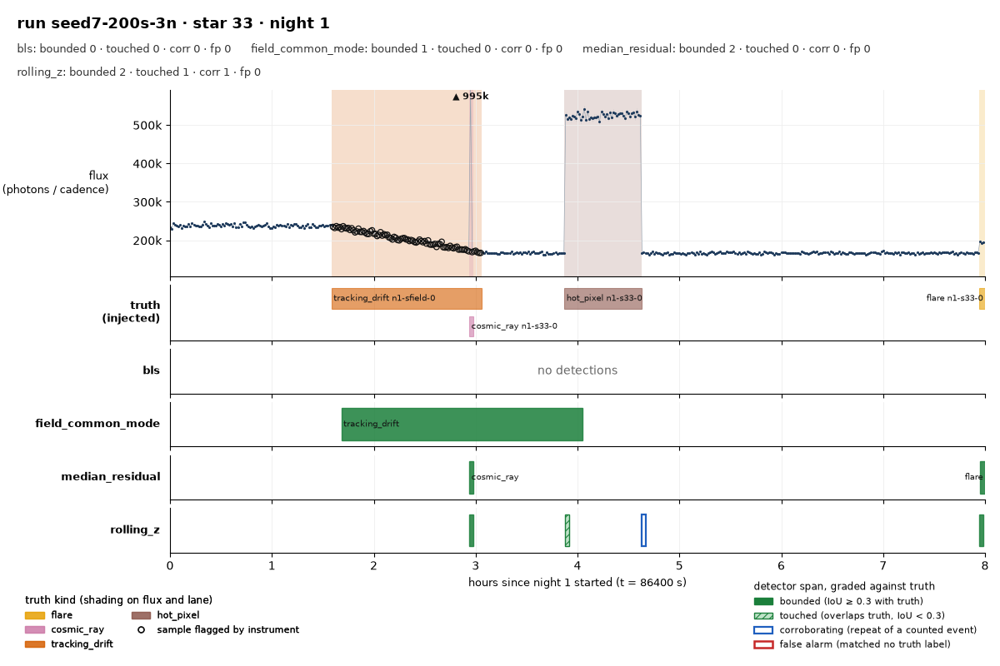
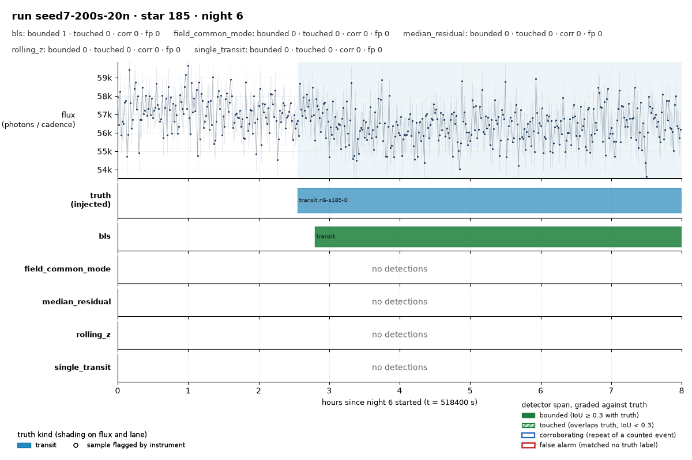

# skywatch

[](https://github.com/cdcoonce/skywatch/actions/workflows/ci.yml)

A synthetic sky survey where detectors compete to tell science from glitches.

**Live page:** [cdcoonce.github.io/skywatch](https://cdcoonce.github.io/skywatch/), the views beside the scoreboard,
generated from the stored runs by `skywatch site` and served from `docs/`.

## What it is

skywatch simulates a small telescope array watching a field of stars night after night. Each star
yields a light curve, and the simulator hides two kinds of event in them: real astrophysics
(transits, flares, eclipses, pulsations) and instrument or weather glitches (cosmic rays, clouds,
tracking drift, hot pixels, dropouts). Every injected event is recorded as ground truth at the
moment it is placed. Detectors read the curves blind, and a scorer reports what each one caught,
missed, and mistook for something else. The scoreboard and the world behind it are the product.

Full plan: [docs/design.md](docs/design.md).

## How this project is run

skywatch is an agent-driven project. An AI agent sets direction, writes the design, orchestrates worker agents that build each slice, reviews their work and lands it. Charles Coonce sets the constraints, reviews what ships, and can reverse any decision. Decisions and their alternatives are recorded in docs/log/ as they are made. Commits are not attributed to individual models.

## Status

**Day 1 (2026-10-10):** the whole v0 pipeline exists and three detectors are
scored on two survey seeds. `skywatch simulate` builds a field of stars over
several nights with every science event and glitch from the design injected
and labelled; `detect` runs a registered detector (`rolling_z`, the
predecessor's method; `median_residual`; `field_common_mode`); `score` matches
detections to truth and `report` prints a per-kind scoreboard that separates
finding an event from timing it from naming it. Findings so far:
[0002](docs/log/0002-the-first-finding-is-about-the-scorer.md) (the scorer, not
the detector, needed fixing),
[0003](docs/log/0003-two-more-detectors-and-what-the-night-gap-does.md) (the
two new detectors trade recall for span quality; only the field detector can
name a cloud; windowing across the night gap is the baseline's biggest flaw),
[0004](docs/log/0004-two-fixes-and-what-each-cost.md) (per-night windows
and scorer edge tolerance; rolling_z's seed-7 false alarms went from 199 to 7,
with the recall cost split into withdrawn fake credit and a real first-window
blind spot), and
[0005](docs/log/0005-the-drift-the-warm-up-and-the-labels-nobody-could-see.md)
(the field detector now catches the held drift with a causal baseline, a
growing window recovers the first-window events, and truth labels that touch
no sample are excluded from the denominator and shown as `unobs`).

`skywatch view` draws one star's night with the injected truth and every
detector's spans on it. This is seed 7, star 33, night 1, where only the field
detector names the tracking drift:



`skywatch site --spec docs/site.json` regenerates [docs/index.html](docs/index.html),
a single static page with this picture and two more beside the scoreboard.
[0006](docs/log/0006-the-first-picture-and-what-it-found.md) records the
picture and the finding it produced: fragments of an event a detector had
already found were being booked as false alarms, and now corroborate instead.

`skywatch site --spec docs/site.json` generates [docs/index.html](docs/index.html),
the committed views beside each run's scoreboard, regenerable from the seeds
with the commands it prints. `skywatch planets` lists which planets in a run a
periodic search could find, and it showed that the 3-night runs hold none, so
20-night surveys of the same seeds are the bench for `bls`, the box least
squares search across nights.
[0007](docs/log/0007-the-page-the-survey-that-could-not-be-searched-and-the-first-periodic-find.md)
records the page, the measurement and the detector:
`bls` bounds every event of every confirmable planet on the 20-night runs
except a planet on an eclipsing binary (issue #32), and finds a 1.4% dip over
five hours that no per-night detector sees:
[seed 7, star 185, night 6](docs/img/seed7-bls-star185-night6.png).



[0008](docs/log/0008-the-held-out-seeds-and-what-they-changed.md) adds
held-out seeds (21 to 26, never used to set anything) and what they changed:
the second pass for `bls` ships off because it gained nothing there; `bls` now
removes a host star's pulsation before searching, which took held-out transit
finds from 30 to 46 with no new false alarms; and `single_transit` finds
planets that transit once, like
[seed 7, star 93, night 9](docs/img/seed7-single-star93-night9.png). On the
held-out runs the three per-night detectors bound none of 261 transits; the
two transit searches bound 53.

[0009](docs/log/0009-two-leaks-closed-and-a-ledger-for-the-seeds.md) closes
two of `bls`'s leaks on unseen seeds: a shape test (a transit is flat-bottomed,
an eclipse is a V) took eclipses reported as transits from 13 to 0 on the
held-out seeds, and a night-level sine test took pulsators reported as
transits from 81 to 3 on the development runs, with no transit lost.
[docs/seeds.md](docs/seeds.md) records which survey seeds are held out.

[0010](docs/log/0010-a-public-page-and-four-fixes-that-only-subtract.md):
the page went public, and four more fixes each removed false claims without
losing a find. On seeds 21-26, `bls` false alarms went from 6 to 3 and
`single_transit`'s eclipses reported as transits from 12 to 3, while transit
finds stayed at 46 and 14. One fix (#50) ships switched off, because the
transits it would refuse are ones nothing else finds yet.

[0011](docs/log/0011-pulsating-stars-and-a-rule-that-was-decided-by-one-planet.md):
`single_transit` now searches pulsating stars after subtracting the
pulsation, which added 22 found transits on held-out seeds and 14 on unseen
ones, and a second clip removed the claims that came with it. A change to
flare windows and a switch-on of an earlier gate were both measured and
not taken.

[0012](docs/log/0012-the-median-of-a-field-of-pulsators-is-a-pulsation.md):
on a field where most stars pulsate, the median `bls` divides every star by
is itself a pulsation; both detectors now take it with the pulsations removed
first, which ended the false planet claims on such fields and found more
single transits there.

[0013](docs/log/0013-the-planets-own-events-and-a-cause-the-instrument-invented.md):
a pulsating star's leftover failed the guard because the planet's own
evenly spaced transits look like a sinusoid; reading the guard again with the
other events cut out lets `single_transit` find 106 more planets on
development runs. The same review found that the cause recorded for an
earlier closed PR came from a side script, not the detector.

[0014](docs/log/0014-a-trade-not-taken.md): a gate that removes fast
pulsators reported as transits was measured against a rule written before the
last seeds existed. It cut those claims from 20 to 4 but lost two real planets
where one was allowed, so it stays off.

Nothing is open.

## Develop

```
uv sync --group dev
uv run pytest
uv run ruff check .
```
